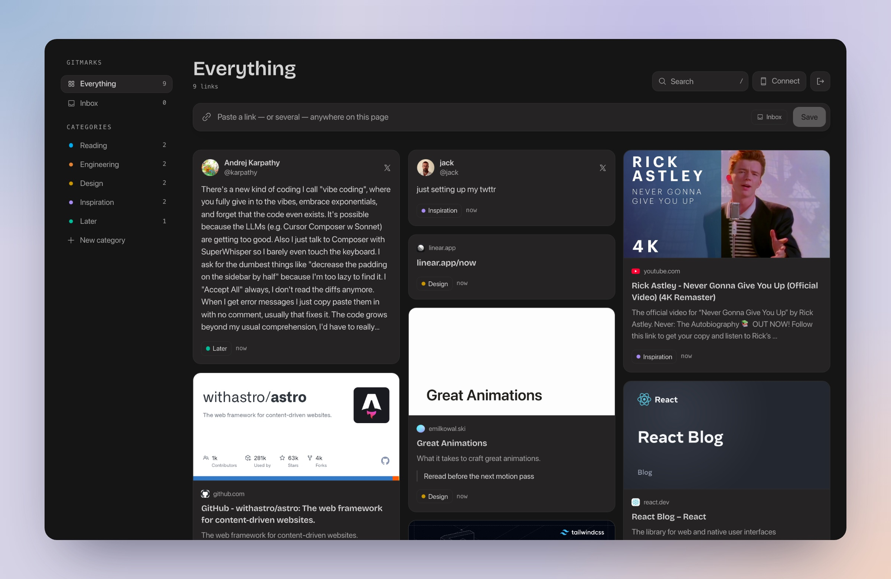
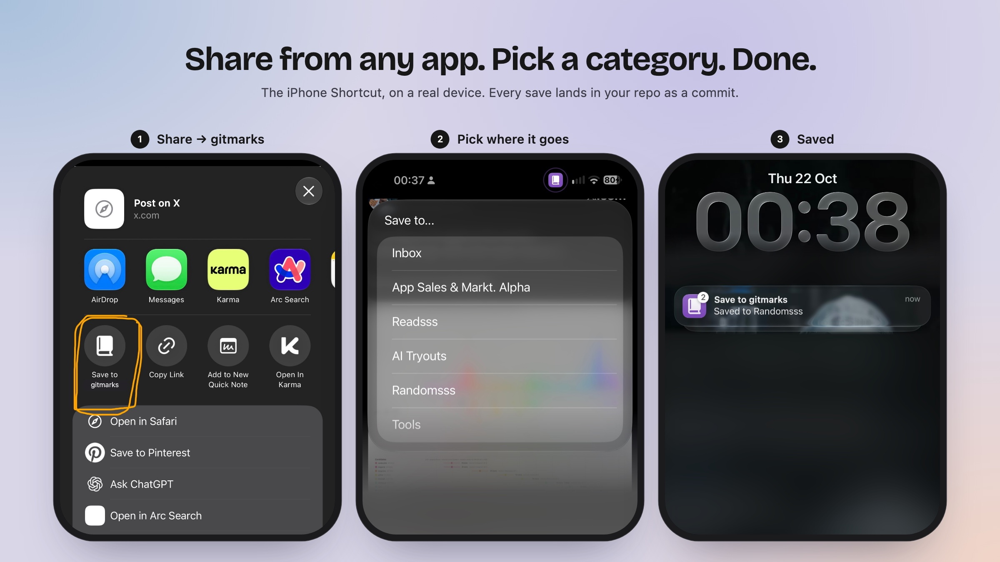
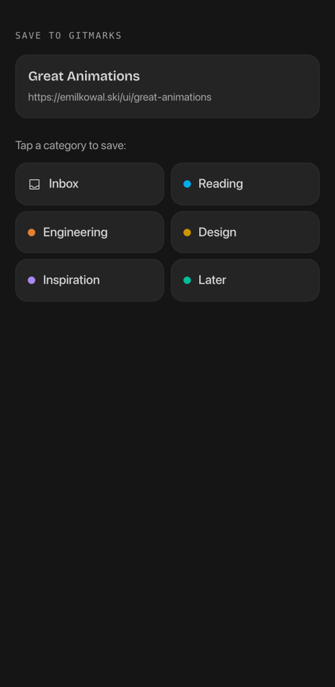
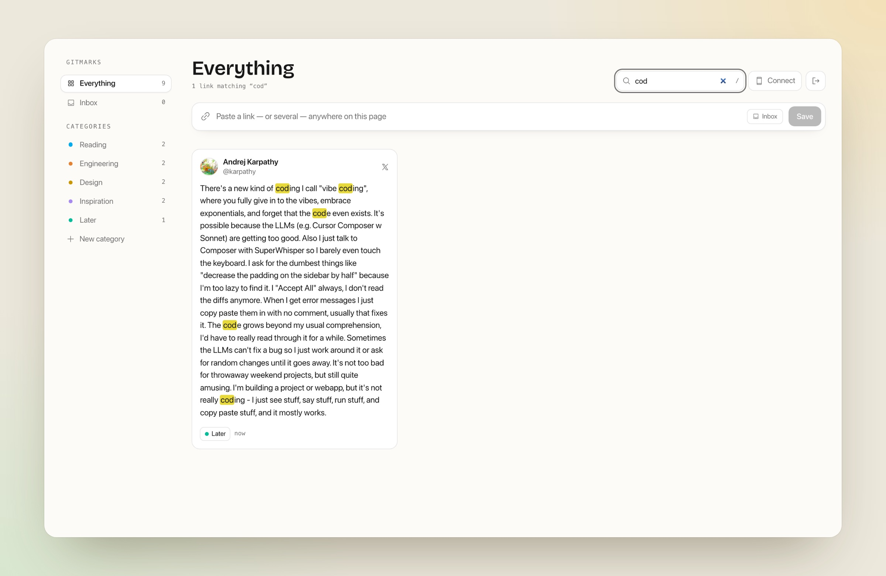
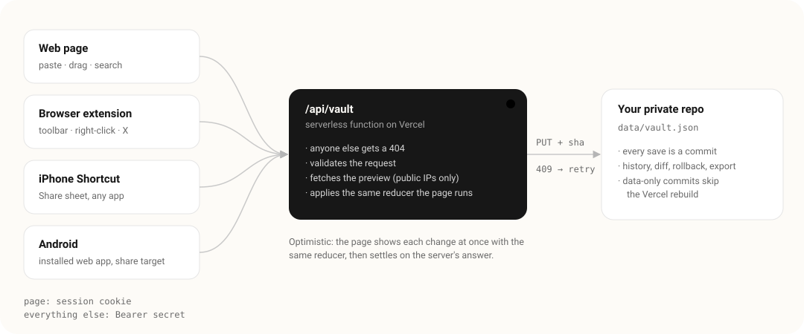

<h1 align="center">gitmarks</h1>

<p align="center">
  <strong>Private, categorised bookmarks that live in your own GitHub repo.</strong><br>
  Save from the web, a browser extension, the X timeline, and the iPhone and Android share sheets.<br>
  No database, no server to run. Every save is a commit.
</p>

<p align="center">
  <a href="https://gitmarks.a9m.pro"><strong>Start free at gitmarks.a9m.pro →</strong></a>
  &nbsp;·&nbsp;
  <a href="#host-it-yourself">or host it yourself</a>
</p>

<p align="center">
  <a href="https://github.com/GeekyADAMS/gitmarks/actions/workflows/ci.yml"></a>
  <a href="https://github.com/GeekyADAMS/gitmarks/actions/workflows/codeql.yml"></a>
  <a href="LICENSE"></a>
</p>

<p align="center">
  <a href="https://geekyadams.github.io/gitmarks/"></a>
  <br>
  <sub>▶ <a href="https://geekyadams.github.io/gitmarks/"><strong>Watch the 30-second intro with sound</strong></a> · <a href="docs/video/gitmarks-intro.mp4">download the MP4</a></sub>
</p>

## Why

X only lets you sort bookmarks into folders if you pay for Premium. Most bookmark
apps want an account and keep your data on their servers. gitmarks sorts
everything, not just X: posts, videos, articles, repos. It keeps all of it as one
JSON file in a private repo that you own. Version history, diffs, rollback and
export come free from git.



## Save from anywhere



| Where                           | How                                                                                                                        |
| ------------------------------- | -------------------------------------------------------------------------------------------------------------------------- |
| **The web page**                | Press ⌘V anywhere, paste several links at once, or drag links in from other tabs. Drop cards onto categories to sort them. |
| **Chrome · Arc · Brave · Edge** | A toolbar button (`Alt+Shift+S`), right-click on any link, and a save button on [every post on X](extension/#readme).      |
| **Safari · Firefox · any**      | A **Save to gitmarks** button you drag to the bookmarks bar, from the Connect menu. Nothing to install.                    |
| **iPhone · iPad**               | A Shortcut in the Share sheet of every app, with a category picker. → [Install it](shortcut/#install-it-two-minutes)       |
| **Android**                     | Install the page to your home screen, and gitmarks joins every app's Share menu. One tap on a category saves.              |

<p align="center"></p>

## What else

- **Rich previews.** Posts on X show text, author and media. Everything else shows its card image, title and description.
- **Search that shows its work.** Matches are highlighted in the title, the text, your notes and the author.
- **Instant.** Every change appears at once, then settles on the server's answer.
- **Undo** on every move and delete. Notes on any card. Rename and merge categories.
- **Light and dark**, following your system.



## Get started

**At [gitmarks.a9m.pro](https://gitmarks.a9m.pro)**, free, in about a minute:

1. **Make a private repo** for your bookmarks. The button on the page fills in GitHub's form for you.
2. **Connect it.** GitHub asks which repos gitmarks may use: choose **Only select repositories** and pick that one. You land back on gitmarks, signed in.
3. **Connect your devices.** Click **Connect** and copy your key into the extension or the iPhone Shortcut. Android and the bookmarks-bar button need no key.

There's no gitmarks account, and gitmarks.a9m.pro keeps no database. It can open only
the one repo you picked, and only its files. See [PRIVACY.md](PRIVACY.md) for exactly
what it sees. To leave, uninstall the app on GitHub: your bookmarks stay in your
repo as one JSON file.

## Host it yourself

**Maximum privacy:** your own copy, on your own Vercel account, so nobody else's
server ever holds a key to your repo. Also free, and about five minutes.

<a href="https://vercel.com/new/clone?repository-url=https%3A%2F%2Fgithub.com%2FGeekyADAMS%2Fgitmarks&project-name=gitmarks&repository-name=gitmarks"></a>

1. **Deploy.** Click the button. Vercel copies gitmarks into a new repo on your GitHub, so **keep "Create private Git Repository" ticked**: your bookmarks will live there.
2. **Open your deployment.** It shows the two settings it still needs, with a secret already made for you and a link that fills in GitHub's token form. You only pick the repo.
3. **Add both in Vercel** (Settings → Environment Variables), then **Redeploy**. Sign in with your secret, which lasts 30 days on each device, and click **Connect** for your devices.

If the repo is ever public, gitmarks pauses saving and tells you, so your bookmarks can't be quietly published.

## How it works



- **Two ways in, one code path.** Self-hosted, a token in the environment reaches one repo. Hosted, a GitHub App does: the server signs who you are and which repo is yours into your cookie, and mints a one-hour token for that one repo on each request. Either way the bookmarks are `data/vault.json`, so moving between the two is copying one file.
- **The JSON file is the database.** Each write sends the sha it read. If the file changed in between, say your phone and laptop saving at once, the server re-reads and re-applies the change instead of overwriting.
- **No redeploys.** Self-hosted, `vercel.json` skips the build when a commit only touches `data/`.
- **One reducer, both sides.** The page applies every change with the same function the server runs (`src/lib/vault.ts`), so the instant view and the stored result can't disagree.
- **Honest limits.** A save takes about a second, because that's the GitHub API's round trip. It's built for one person, not a team.

## Security

Anyone who isn't signed in gets a 404 from the API. Sessions are signed and expire.
Writes from other sites are rejected. Link previews can only reach the public
internet, never the server's own network. Hosted, every GitHub token is narrowed to
one repo and Contents, and expires within the hour. The full threat model, every control, and the known
limitations are in [SECURITY.md](SECURITY.md). Please report vulnerabilities
privately.

## Settings

Self-hosted:

| Variable                | Required  |                                                         |
| ----------------------- | --------- | ------------------------------------------------------- |
| `GITMARKS_SECRET`       | yes       | At least 24 characters; 32+ random recommended          |
| `GITHUB_TOKEN`          | on Vercel | Fine-grained, this repo only, Contents: read and write  |
| `GITMARKS_REPO`         | no        | `owner/name`. Defaults to the repo Vercel deployed from |
| `GITMARKS_BRANCH`       | no        | Defaults to the deployed branch, then `main`            |
| `GITMARKS_ALLOW_PUBLIC` | no        | `true` to keep saving to a public repo on purpose       |

Hosted mode, for running a gitmarks that serves everyone, like gitmarks.a9m.pro. Setting
all four `GITHUB_APP_*` values switches it on. `node scripts/create-github-app.mjs
https://your-domain` registers the app in one click and writes them for you.

| Variable                   |                                                       |
| -------------------------- | ----------------------------------------------------- |
| `GITMARKS_SECRET`          | Signs sessions and device keys. 32+ random characters |
| `GITHUB_APP_CLIENT_ID`     | From the GitHub App                                   |
| `GITHUB_APP_CLIENT_SECRET` | From the GitHub App                                   |
| `GITHUB_APP_PRIVATE_KEY`   | The app's PEM. Newlines may be written as `\n`        |
| `GITHUB_APP_SLUG`          | The app's URL name, as in `github.com/apps/<slug>`    |

## Develop

```bash
pnpm install
cp .env.example .env     # set GITMARKS_SECRET
pnpm dev                 # http://localhost:4321
pnpm verify              # format, lint, types, tests, build, smoke test
```

Without `GITHUB_TOKEN`, bookmarks are saved to `.gitmarks-local.json`, which git
ignores. Contributions are welcome within the project's scope: read
[CONTRIBUTING.md](CONTRIBUTING.md) first.

## Licence

[MIT](LICENSE)
